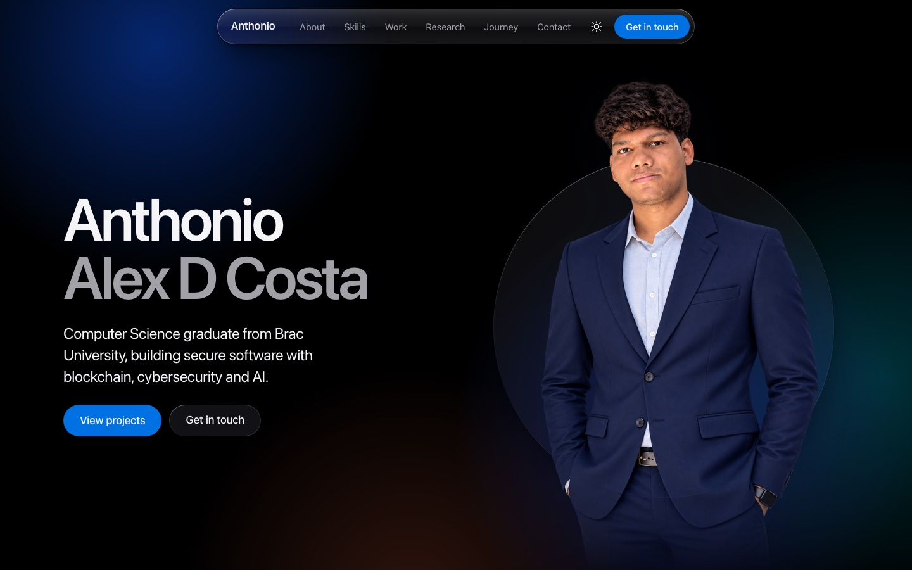
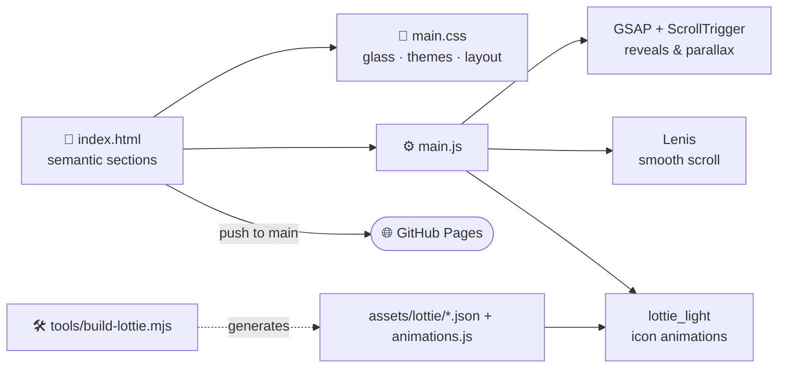

<!-- ═══════════════════════════ HEADER ═══════════════════════════ -->
<p align="center">
  
</p>

<p align="center">
  
</p>

<p align="center">
  <a href="https://anthonio-alex-dcosta.github.io/portfolio/"></a>
</p>

<p align="center">
  <a href="https://anthonio-alex-dcosta.github.io/portfolio/">
    
  </a>
</p>

<p align="center">
  
  
  
  
  
  
</p>

<p align="center">
  
  
  
  
</p>

---

## 🪩 About this site

My personal website: a Computer Science graduate from **Brac University** building secure software with **blockchain, cybersecurity and AI**.

Visually it borrows from Apple's **liquid-glass** language, with frosted translucent panels, soft depth and smooth scroll-driven motion. Underneath, it's plain **HTML, CSS and JavaScript**. There's no React, no bundler and no build step, so the code you read here is the code the browser runs.

---

## 🧭 What's inside

<table>
  <tr>
    <td width="33%" valign="top">
      <h3>👋 About</h3>
      Research interests, tutoring experience and a short introduction.
    </td>
    <td width="33%" valign="top">
      <h3>🛠️ Skills</h3>
      Core focus, languages, web and blockchain, databases and tools, and professional skills.
    </td>
    <td width="33%" valign="top">
      <h3>🚀 Selected work</h3>
      Project cards for StoryGram, Missing Persons DApp, Metaverse ID and more.
    </td>
  </tr>
  <tr>
    <td width="33%" valign="top">
      <h3>📄 Research</h3>
      <i>Enabling Decentralized Identities in Metaverses Leveraging Self-sovereign Identity</i>
    </td>
    <td width="33%" valign="top">
      <h3>🎓 Journey</h3>
      A timeline from school to a BSc in CSE and student tutoring.
    </td>
    <td width="33%" valign="top">
      <h3>✉️ Contact</h3>
      <i>"Let's create something together."</i>
    </td>
  </tr>
</table>

---

## ✨ Craft details

| | Detail |
| :--: | :-- |
| 🫧 | **Liquid-glass surfaces** built from layered `backdrop-filter` blur and translucency |
| 🌗 | **Light and dark themes** with a toggle in the nav |
| 🎞️ | **GSAP + ScrollTrigger** reveal sections as you scroll |
| 🧈 | **Lenis** smooth scrolling for a native-app feel |
| ✏️ | **Hand-authored Lottie icons**, generated in code by `tools/build-lottie.mjs` and recoloured per theme in CSS |
| 📱 | **Phone layout** with an iOS-style bottom tab bar and a centred orbit hero |
| ♿ | **`prefers-reduced-motion`** respected, so animation backs off for people who ask for less |
| 📸 | **Credited photography.** Every project image is openly licensed and listed in `credits.json` |
| 📂 | **Opens from `file://`.** Lottie data ships as JS, so the site works even without a server |

---

## 🏗️ How it fits together



<details>
<summary><b>📂 Project structure</b></summary>

```text
portfolio/
├── index.html                 every section of the site
├── assets/
│   ├── css/main.css           design tokens, glass surfaces, themes, responsive layout
│   ├── js/main.js             scroll motion, theme toggle, nav, Lottie wiring
│   ├── lottie/                generated icon animations
│   ├── img/projects/          project photography + credits.json
│   └── vendor/                GSAP, ScrollTrigger, Lenis, lottie_light (pinned, self-hosted)
├── tools/build-lottie.mjs     generates the Lottie icons from code
└── .nojekyll                  serve files as-is on GitHub Pages
```

</details>

---

## 🚀 Run it locally

```bash
git clone https://github.com/anthonio-alex-dcosta/portfolio.git
cd portfolio
open index.html            # or: npx serve .

# optional: regenerate the Lottie icons
node tools/build-lottie.mjs
```

---

<p align="center">
  <a href="https://anthonio-alex-dcosta.github.io/portfolio/"></a>
  <a href="https://www.linkedin.com/in/anthonio-alex-d-costa-515aba373"></a>
  <a href="https://github.com/anthonio-alex-dcosta"></a>
</p>

<p align="center">
  
</p>
